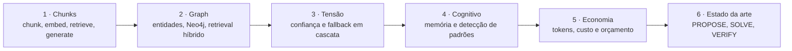

# RAG Dojo

Do zero ao estado da arte em RAG, em **6 espirais**: chunking e recuperação, Graph RAG com Neo4j, orquestração por
confiança, camada cognitiva, controle de custo e um laço de auto-melhoria.

É um projeto de estudo, não um sistema de produção. Cada espiral é um pacote Python independente, com testes,
e só depende das anteriores.

## Como as espirais se encaixam



As dependências vão só para frente, sem imports circulares. A espiral seguinte usa apenas os símbolos exportados
pela anterior ([ADR 003](docs/adr/003-spiral-architecture.md)).

## As espirais

| # | Pacote | O que contém |
|---|---|---|
| 1 | `spiral_01_chunks/` | Chunker, embeddings (incluindo binários), vector store, retriever, expansão de consulta, compressão de contexto, geração com Groq ou Ollama |
| 2 | `spiral_02_graph/` | Extração de entidades, grafo no Neo4j, retrieval híbrido (vetor + grafo), reranker, Graph RAG, visualizador |
| 3 | `spiral_03_orchestration/` | Campo de tensão, pontuação de confiança, fallback em cascata e orquestrador |
| 4 | `spiral_04_cognitive/` | Memória, detecção de padrões, verificação de limites (thresholds) e métricas |
| 5 | `spiral_05_economics/` | Contagem de tokens, cálculo de custo, orçamento, circuit breaker, roteamento de modelo, cache semântico e pipeline em camadas (L0 a L3) |
| 6 | `spiral_06_state_of_art/` | Laço PROPOSE, SOLVE, VERIFY, com scorer, guardrails, suíte de benchmark e relatório |

## Decisões de arquitetura

- [ADR 001](docs/adr/001-chromadb-over-alternatives.md): ChromaDB em vez de FAISS, Pinecone e Weaviate.
- [ADR 002](docs/adr/002-groq-free-tier-strategy.md): Groq (camada gratuita) com Ollama como fallback local.
- [ADR 003](docs/adr/003-spiral-architecture.md): por que seis espirais independentes e testáveis.

## Stack

| Tecnologia | Uso |
|---|---|
| Python 3.12 | Runtime |
| ChromaDB | Vector store |
| sentence-transformers | Embeddings (all-MiniLM-L6-v2) |
| Neo4j | Graph store (espiral 2 em diante) |
| Groq | Provedor de LLM (camada gratuita) |
| Ollama | LLM local de fallback |
| rich | Saída da CLI |
| pytest | Testes |

## Início rápido

```bash
# 1. Clone
git clone https://github.com/HuggsF/rag-dojo.git
cd rag-dojo

# 2. Ambiente virtual
python -m venv venv
source venv/bin/activate  # Linux/Mac
# venv\Scripts\activate   # Windows

# 3. Dependências
pip install -r requirements.txt

# 4. Variáveis de ambiente
cp .env.example .env
# Preencha GROQ_API_KEY (gratuita: https://console.groq.com)

# 5. Baixe documentação pública para os dados de treino
python spiral_01_chunks/download_docs.py

# 6. Rode o pipeline da espiral 1
python -m spiral_01_chunks.pipeline ingest ./data/fastapi_docs/
python -m spiral_01_chunks.pipeline ask "Como criar um middleware no FastAPI?"

# 7. Testes
pytest
```

## Testes

```bash
pytest                          # todos
pytest tests/spiral_01/         # apenas a espiral 1
pytest --cov=spiral_01_chunks   # com cobertura
```

O repositório tem cerca de 900 funções de teste, e a CI define o mínimo de 90% de cobertura por arquivo
(`scripts/check_coverage.py`). Ainda não há resultados de benchmark publicados.

## Dados

Apenas documentação pública de código aberto. Nenhum dado de cliente nem de negócio.

## Licença

MIT. Veja [LICENSE](LICENSE).
